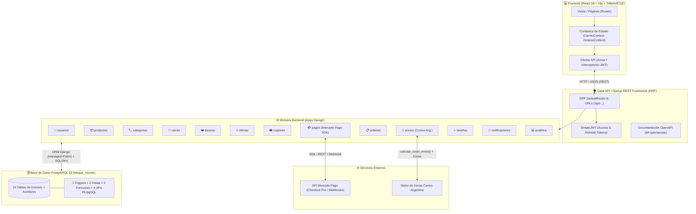
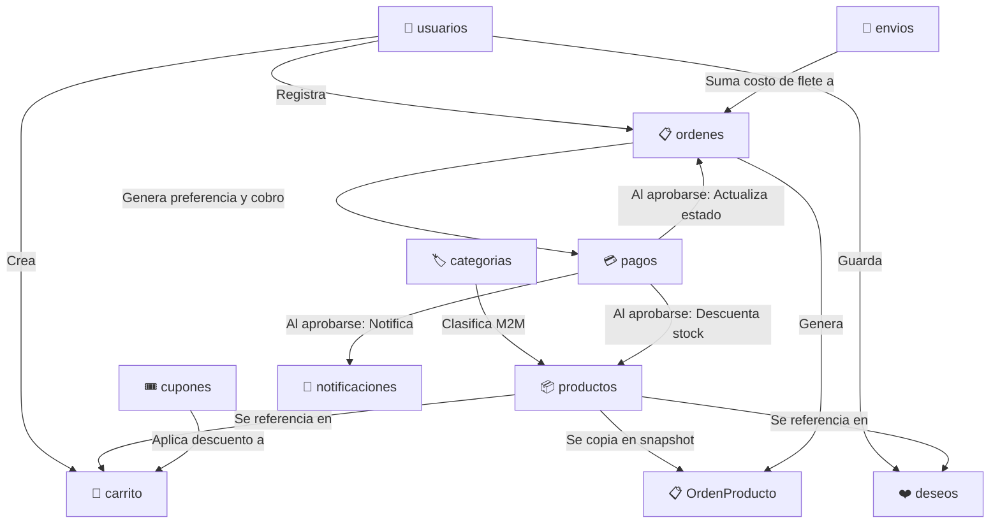

# 🏗️ Arquitectura Técnica y Funcionamiento Modular del E-Commerce
> **Documento:** Especificación Técnica de Arquitectura, Módulos, Base de Datos PostgreSQL y Flujos de Datos  
> **Stack Principal:** Python 3.12 / Django 4.2 / Django REST Framework / **PostgreSQL 18 (`bloque_mundo`)** + React 18 / Vite / TailwindCSS / GSAP (Frontend)

---

## 🏛️ 1. Diagrama de Arquitectura General del Sistema

El sistema implementa una arquitectura desacoplada **Frontend SPA (Single Page Application) + Backend REST API**, con autenticación híbrida (JWT para usuarios registrados y `session_key` para compradores invitados), y conexión a servicios de terceros (Mercado Pago y Correo Argentino).



---

## 📦 2. Desglose Técnico de Módulos (Backend Apps)

A continuación se detalla la responsabilidad técnica de cada aplicación, sus modelos principales y sus interconexiones:

### 👤 2.1. `usuarios` (Autenticación y Perfiles → tabla `usuario`)
* **Responsabilidad:** Gestiona la creación de cuentas, inicio de sesión, autorización y datos de perfil extendidos.
* **Modelo Principal:** `Usuario` (`db_table = 'usuario'`, `managed = False`, hereda de `AbstractBaseUser` y `PermissionsMixin`):
  * Mapeo 1:1 con columnas SQL: `id_usuario`, `nombre`, `apellido`, `correo` (con `CHECK` regex), `direccion`, `codigo_postal`, `es_admin`, más columnas técnicas de autenticación (`username`, `password`, `is_active`, `is_superuser`, `last_login`, `date_joined`).
* **Seguridad:** Usa **SimpleJWT** (`/api/login/` y `/api/token/refresh/`) emitiendo tokens con firma criptográfica.

---

### 🏷️ 2.2. `categorias` y `productos` (Catálogo e Inventario → tablas `categoria`, `edad`, `pelicula`, `producto`, `movimiento_stock`)
* **Responsabilidad:** Administración del catálogo, control de stock con auditoría y clasificación por categoría, rango etario y saga/película.
* **Modelos:**
  * `Categoria` (`db_table = 'categoria'`): `id_categoria`, `nombre_categoria`, `descripcion`, `activo`.
  * `Edad` (`db_table = 'edad'`): 5 rangos etarios (`0 - 3 años`, `4 - 6 años`, `7 - 11 años`, `12 - 17 años`, `18+ Adultos`).
  * `Pelicula` (`db_table = 'pelicula'`): 18 sagas/franquicias (`Star Wars`, `Harry Potter`, `Marvel`, `Technic`, etc.).
  * `Producto` (`db_table = 'producto'`): `id_producto`, `nombre_producto`, `descripcion`, `precio` (`CHECK > 0`), `stock` (`CHECK >= 0`), `destacado`, FKs `id_categoria`, `id_edad`, `id_pelicula`, `imagen`, `activo`, `creado`.
  * `MovimientoStock` (`db_table = 'movimiento_stock'`): auditoría inmutable con ENUM `tipo_movimiento_enum` (`INGRESO`, `INGRESO_ADMIN`, `VENTA`, `DEVOLUCION_CANCELACION`, `AJUSTE`).
* **Endpoints Clave:**
  * `GET /api/productos/`: Listado público con filtros por `saga`, `pelicula`, `edad`, `categorias__nombre`, `precio_min`, `precio_max`, `en_stock`, `destacado` y búsqueda.
  * `GET /api/productos/inventario_critico/`: Lee directamente la vista PostgreSQL `vista_inventario_critico`.
  * `GET /api/productos/filtrar_sp/`: Invoca la función PostgreSQL `filtrar_productos(id_categoria, id_edad, id_pelicula)`.
  * `POST /api/productos/{id}/reponer_stock/` y `destacar/`: Invocan `CALL pr_gestion_stock(...)` y `CALL pr_destacar_producto(...)`.

---

### 🛒 2.3. `carrito` y `deseos` (Persistencia Anti-Fantasma → tablas `carrito`, `linea_carrito`, `deseos_deseo`)
* **Responsabilidad:** Almacenamiento de productos preseleccionados antes de pagar sin bloquear stock del inventario.
* **Estructura en PostgreSQL:**
  * `carrito` (`id_carrito`, `id_usuario` único 1:1 o `session_key` para invitados, `total`).
  * `linea_carrito` con clave primaria compuesta `(id_carrito, id_producto)`, `cantidad` y `subtotal`.
  * **Trigger 5 (`trg_actualizar_total_carrito`):** Recalcula automáticamente `carrito.total` ante cada `INSERT`, `UPDATE` o `DELETE` en `linea_carrito`.
  * **SP `pr_agregar_al_carrito`:** Valida stock disponible antes de insertar/actualizar `linea_carrito`.
  * **Combos (`POST /api/carrito/agregar_combo/`):** Prorratea el precio exacto del combo entre sus productos en `linea_carrito.subtotal` para mantener el precio cerrado del combo y que al comprar se descuente el stock de cada set incluido.
  * **Sanitización Anti-Fantasma:** Cada consulta a `/api/carrito/` o `/api/carrito/resumen/` depura automáticamente ítems inactivos o sin stock y ajusta cantidades al stock real.

---

### 🎟️ 2.4. `cupones` y `ofertas` (Motor Promocional → tablas `cupon`, `promocion`, `ofertas_combo`, `ofertas_comboproducto`)
* **Responsabilidad:** Cupones de descuento, promociones temporales por producto y combos armados desde el Panel Admin.
* **Modelo `Cupon` (`db_table = 'cupon'`):** `id_cupon`, `codigo`, `porcentaje` (`CHECK 0 < p <= 100`), `usado`, `fecha_vencimiento`.
* **Modelo `Oferta` (`db_table = 'promocion'`):** `id_promo`, `id_producto`, `descripcion_promo`, `fecha_inicio`, `fecha_fin` (`CHECK fecha_fin > fecha_inicio`), `porcentaje_descuento`, `activo`.
* **Modelos `Combo` y `ComboProducto`:** Agrupan múltiples productos a un precio especial; el descuento de stock de los productos incluidos ocurre al concretar la compra (no al crear el combo).

---

### 🚚 2.5. `envios` (Motor de Cotización y Zonas → tabla `envio`)
* **Responsabilidad:** Cálculo dinámico de costos de flete por Código Postal integrando la función PostgreSQL `calcular_costo_envio(cp)` con las zonas de Correo Argentino.
* **Lógica (`envios/views.py` + `correo_argentino.py`):**
  * Ejecuta `SELECT calcular_costo_envio(cp)` en PostgreSQL (`$3.500` base + recargo por zona).
  * Devuelve las 3 modalidades (`Envío a Domicilio`, `Retiro en Sucursal`, `Retiro en Tienda` `$0`) y aplica **Envío Gratis** cuando el subtotal supera `ConfiguracionEnvio.monto_envio_gratis` (`$50.000`).
* **Endpoint:** `POST / GET /api/envios/cotizar/`.

---

### 📋 2.6. `ordenes` (Ciclo de Vida del Pedido → tablas `compra`, `linea_compra`)
* **Responsabilidad:** Registro inmutable del pedido y ejecución de la lógica transaccional de compra en PostgreSQL.
* **Flujo transaccional (`POST /api/ordenes/ordenes/crear_orden_usuario/`):**
  * Invoca `CALL pr_concretar_compra(p_id_usuario, p_direccion_envio, p_codigo_cupon)` en PostgreSQL:
    1. Valida stock de cada ítem en `linea_carrito`.
    2. Valida y marca el cupón como usado si corresponde.
    3. Calcula envío con `calcular_costo_envio()`.
    4. Inserta en `compra`, `linea_compra` (**Trigger 2** → inserta `VENTA` en `movimiento_stock` → **Trigger 1** descuenta `producto.stock`), `pago` (**Trigger 6** valida `monto <= compra.total`) y `envio`, y limpia `linea_carrito`.
* **Reportes e Historial:**
  * `GET /api/ordenes/ordenes/historial_sp/`: Invoca la función `historial_compras_usuario(id_usuario)`.
  * `GET /api/ordenes/ordenes/reporte_ventas/`: Integra métricas y la vista PostgreSQL `vista_reporte_ventas`.

---

### 💳 2.7. `pagos` (Integración Mercado Pago SDK y Webhooks → tabla `pago`)
* **Responsabilidad:** Crear preferencias de Checkout Pro, validar notificaciones de pago y sincronizar el estado en PostgreSQL (`estado_pago_enum`: `'PENDIENTE'`, `'APROBADO'`, `'CANCELADO'`).
* **Triggers de Integridad:**
  * **Trigger 3 (`trg_reponer_stock_por_cancelacion`):** Al actualizar `pago.estado_pago` a `'CANCELADO'`, inserta automáticamente `DEVOLUCION_CANCELACION` en `movimiento_stock` y repone el stock de todos los productos de la compra.
  * **Trigger 4 (`trg_bloquear_edicion_linea_compra`):** Bloquea cualquier modificación o borrado en `linea_compra` una vez que el pago está `'APROBADO'`.
  * **Trigger 6 (`trg_validar_pago_no_supera_total`):** Impide registrar un pago cuyo monto supere el total de la compra.
* **Auto-Return Inteligente:** Envía `auto_return: "approved"` únicamente cuando `back_urls.success` es una URL pública HTTPS (producción o túnel HTTPS), evitando el error `invalid_auto_return` de Mercado Pago en `localhost`.

---

### ⭐ 2.8. `reseñas` (tabla `comentario`), `notificaciones` y `analitica`
* **`reseñas` (`db_table = 'comentario'`):** Protegida por el **Trigger 7 (`trg_validar_comentario_compra_previa`)**, que valida directamente en PostgreSQL que el usuario haya comprado el producto antes de permitir el `INSERT`.
* **`notificaciones` y `analitica`:** Plantillas de correo transaccional y registro de eventos de analítica.

---

## 🔄 3. Matriz de Conectividad e Interacción entre Módulos



---

## 💻 4. Estructura y Funcionamiento del Frontend (React + Vite)

### 📁 Estructura del Directorio `frontend/tienda/src/`:
```
src/
├── assets/
│   ├── components/    # Componentes reutilizables (Navbar, Footer, ProductCard, etc.)
│   └── pages/         # Vistas / Rutas (Inicio, Detalle, Checkout, AdminDashboard, etc.)
├── context/
│   ├── CarritoContext.jsx   # Estado global del carrito y sincronización con API/LocalStorage
│   └── DeseosContext.jsx    # Estado global de la lista de deseos
├── services/          # Clientes de llamada a endpoints específicos
├── api.jsx            # Instancia Axios con interceptores JWT y auto-renovación de token
├── config.js          # URL base de la API y constantes de entorno
├── routes.jsx         # Definición de rutas con React Router DOM v6
└── main.jsx           # Punto de entrada de la aplicación
```

### 🔐 Gestión de Sesión y Manejo de Tokens (`api.jsx`):
1. **Peticiones salientes:** El interceptor inyecta el encabezado `Authorization: Bearer <access_token>`.
2. **Detección de expiración:** Decodifica el payload JWT (`exp`) antes de enviar. Si expiró, invoca automáticamente `refreshAccessToken()` contra `/api/token/refresh/` antes de cursar la petición original.
3. **Respuesta 401 (Unauthorized):** Si la API responde 401, intenta un reintento con refresh token; si falla, limpia el `localStorage` y redirige de manera segura a `/login`.

### ✨ 4.3. Motor de Animaciones Interactivas y Efectos de Cursor (GSAP - GreenSock):
El frontend utiliza la librería de alto rendimiento **GSAP (GreenSock Animation Platform)** (`gsap ^3.15.0`) para proporcionar una experiencia de usuario interactiva y fluida:

1. **Spotlight / Seguidor del Cursor en Tiempo Real:**
   * **Implementación:** Mediante `gsap.quickTo()`, optimizado para actualizar coordenadas `(x, y)` sin sobrecargar el hilo principal de React.
   * **Ubicación:** En [Header.jsx](file:///c:/Users/agust/Desktop/Web-Ecommerce-main/Web-Ecommerce-main/frontend/tienda/src/assets/components/Header.jsx) y [HeroSection.jsx](file:///c:/Users/agust/Desktop/Web-Ecommerce-main/Web-Ecommerce-main/frontend/tienda/src/assets/components/HeroSection.jsx), generando un foco de luz (*spotlight*) suave y dinámico que sigue la trayectoria exacta del puntero del mouse.
2. **Inclinación y Perspectiva 3D (*3D Tilt & Parallax*):**
   * Al mover el cursor sobre la sección principal (*Hero*), las tarjetas y las imágenes reaccionan rotando sutilmente en los ejes tridimensionales (`rotationX`, `rotationY`, `x`, `y`) con curvas de desaceleración suave (`ease: "power2.out"`), creando una sensación inmersiva de profundidad y relieve.
3. **Elementos Flotantes Continuos:**
   * Animaciones en bucle con interpolación senoidal (`sine.inOut`) para bloques decorativos 3D que flotan en el fondo de manera autónoma.
4. **Líneas de Tiempo de Transición (*Timelines*):**
   * Uso de `gsap.timeline()` para coordinar la entrada escalonada (*stagger*) de textos, insignias, botones y transiciones de diapositivas en el banner principal.

---

## 📡 5. Mapa de Rutas de la API REST (Backend Endpoints)

| Método | Endpoint | Módulo | Acceso | Descripción |
| :--- | :--- | :--- | :--- | :--- |
| `POST` | `/api/login/` | `usuarios` | Público | Obtención de tokens JWT (`access` y `refresh`). |
| `POST` | `/api/token/refresh/` | `usuarios` | Público | Renovación de `access_token` mediante `refresh_token`. |
| `GET` | `/api/productos/` | `productos` | Público | Consulta de catálogo con filtros (`saga`, `edad`, `precio_min/max`, `en_stock`, `destacado`). |
| `GET` | `/api/productos/inventario_critico/` | `productos` | Público | Consulta directa a la vista PostgreSQL `vista_inventario_critico`. |
| `GET` | `/api/productos/filtrar_sp/` | `productos` | Público | Invoca la función PostgreSQL `filtrar_productos()`. |
| `POST` | `/api/productos/` | `productos` | Admin / Staff | Alta de nuevo producto con imagen. |
| `GET/POST`| `/api/carrito/` | `carrito` | Autenticado / Sesión | Consulta (sanitizada anti-fantasma) y adición vía `pr_agregar_al_carrito`. |
| `POST` | `/api/carrito/agregar_combo/` | `carrito` | Autenticado / Sesión | Agrega los productos de un combo respetando su precio cerrado prorrateado. |
| `POST/GET`| `/api/envios/cotizar/` | `envios` | Público | Cotización por CP usando `calcular_costo_envio()` de PostgreSQL + Correo Argentino. |
| `POST` | `/api/cupones/validar/` | `cupones` | Público | Validación de vigencia y descuento de cupón. |
| `POST` | `/api/ordenes/ordenes/crear_orden_usuario/` | `ordenes` | Autenticado | Ejecuta `CALL pr_concretar_compra(...)` en PostgreSQL (dispara Triggers 1, 2, 5 y 6). |
| `GET` | `/api/ordenes/ordenes/reporte_ventas/` | `ordenes` | Admin / Staff | Métricas de ventas + vista PostgreSQL `vista_reporte_ventas`. |
| `POST` | `/api/pagos/pagos/crear-preferencia/` | `pagos` | Público / Usuario | Creación de preferencia de cobro en Mercado Pago. |
| `POST` | `/api/pagos/pagos/webhook/` | `pagos` | Público (MP) | Receptor de eventos IPN de Mercado Pago (Trigger 3 repone stock al cancelar). |
| `POST` | `/api/pagos/pagos/confirmar-retorno/` | `pagos` | Público | Sincronización de estado de pago (`APROBADO`/`CANCELADO`) tras retorno. |
| `GET` | `/api/swagger/` | `core` | Público | Documentación interactiva Swagger / OpenAPI. |

---

## ⚡ 6. Capacidades Nativas de Django y Procesos Tradicionales que Reemplazan

El backend aprovecha la arquitectura *"batteries-included"* (con todo incluido) del framework Django y de Django REST Framework (DRF). A continuación se especifican las funciones clave utilizadas en el sistema y qué procesos tradicionales de desarrollo reemplazan:

| Capacidad / Módulo de Django | Función en el Sistema | Proceso Tradicional que Reemplaza |
| :--- | :--- | :--- |
| **Django ORM** (*Object-Relational Mapping*) | Consultas y persistencia mediante clases Python (`Producto.objects.filter(...)`, `Carrito.objects.get(...)`). | ❌ Escribir sentencias SQL manuales (`SELECT`, `INSERT`, `UPDATE`), mapear filas a objetos y lidiar con vulnerabilidades de **inyección SQL**. |
| **Sesiones para Invitados** (`django.contrib.sessions`) | Asignación de `session_key` para permitir a compradores anónimos armar un carrito antes de registrarse. | ❌ Diseñar mecanismos propios de cookies firmadas, control de expiración y servidores de estado temporal (e.g. Redis) para carritos de invitados. |
| **Panel de Administración** (`django.contrib.admin` + Jazzmin) | Back-office administrativo completo para gestionar productos, órdenes, stock y usuarios. | ❌ Diseñar y programar un frontend completo de gestión comercial (formularios, tablas paginadas, carga de imágenes) solo para los administradores. |
| **Gestor de Correos** (`django.core.mail`) | Envío de notificaciones transaccionales (bienvenida, confirmación de orden, pagos) vía SMTP / Resend. | ❌ Configurar sockets de red SMTP de bajo nivel, manipulación manual de cabeceras MIME multiparte (texto/HTML/adjuntos) y control de conexiones SSL/TLS. |
| **Middlewares de Seguridad y CORS** (`SecurityMiddleware`, `CorsMiddleware`) | Control de orígenes permitidos (CORS) y protección automática contra XSS, Clickjacking y CSRF. | ❌ Configurar reglas complejas en servidores web externos (Nginx/Apache) o cabeceras HTTP manuales en cada vista. |
| **Generador OpenAPI / Swagger** (`drf_spectacular`) | Generación automática de la documentación interactiva de la API basada en la introspección del código. | ❌ Redactar y sincronizar manualmente archivos Swagger JSON, colecciones de Postman o documentos que se desactualizan con cada cambio en el código. |
| **Motor de Archivos Estáticos** (`WhiteNoise` / `staticfiles`) | Servido eficiente y comprimido (Gzip/Brotli) de archivos estáticos del panel admin directamente desde la app. | ❌ Depender obligatoriamente de un servidor web proxy adicional solo para entregar archivos CSS, JS y fuentes de administración. |
| **Sistema de Migraciones** (`makemigrations` / `migrate`) | Generación y control de versiones del esquema de base de datos desde los modelos Python. | ❌ Escribir scripts DDL (`ALTER TABLE`, `CREATE INDEX`) y coordinar manualmente cambios de esquema entre entornos (dev, staging, prod). |
| **Autenticación y Seguridad de Usuarios** (`django.contrib.auth` / `AbstractUser`) | Manejo de cuentas, roles, permisos y hashing criptográfico de contraseñas. | ❌ Implementar algoritmos de encriptación (PBKDF2/Argon2/bcrypt), manejo de *salts*, tablas de permisos y políticas de contraseñas seguras desde cero. |
| **DRF: ViewSets y Routers** (`rest_framework.viewsets`) | Generación automática de endpoints REST y lógica CRUD completa con mínimas líneas de código. | ❌ Crear controladores o rutas individuales para cada método HTTP (`GET`, `POST`, `PUT`, `DELETE`), parsear parámetros de URL y gestionar códigos de respuesta manualmente. |
| **DRF: Serializadores** (`serializers.ModelSerializer`) | Conversión bidireccional entre instancias de modelos y JSON; validación estricta de payloads entrantes. | ❌ Escribir lógica manual de validación de tipos, sanitización de datos contra código malicioso y formateo manual de diccionarios JSON con `json.dumps()`.
