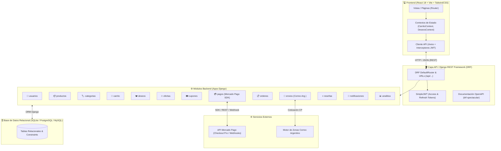
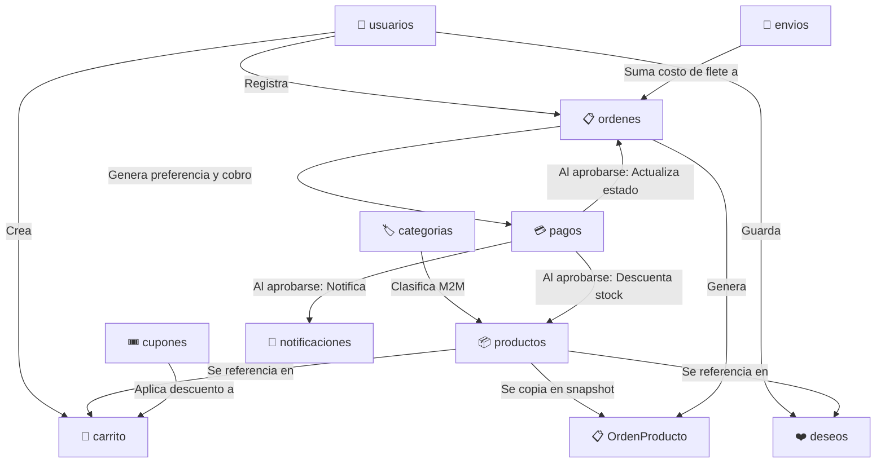

# 🏗️ Arquitectura Técnica y Funcionamiento Modular del E-Commerce
> **Documento:** Especificación Técnica de Arquitectura, Módulos, Conectividad y Flujos de Datos  
> **Stack Principal:** Python 3.10+ / Django 4.2 / Django REST Framework (Backend) + React 18 / Vite / TailwindCSS / GSAP (Frontend)

---

## 🏛️ 1. Diagrama de Arquitectura General del Sistema

El sistema implementa una arquitectura desacoplada **Frontend SPA (Single Page Application) + Backend REST API**, con autenticación híbrida (JWT para usuarios registrados y `session_key` para compradores invitados), y conexión a servicios de terceros (Mercado Pago y Correo Argentino).



---

## 📦 2. Desglose Técnico de Módulos (Backend Apps)

A continuación se detalla la responsabilidad técnica de cada aplicación, sus modelos principales y sus interconexiones:

### 👤 2.1. `usuarios` (Autenticación y Perfiles)
* **Responsabilidad:** Gestiona la creación de cuentas, inicio de sesión, autorización y datos de perfil extendidos.
* **Modelo Principal:** `Usuario` (hereda de `AbstractUser` de Django):
  * Atributos extra: `direccion`, `telefono`, `ciudad`, `comuna`, `codigo_postal`, `fecha_nacimiento`.
* **Seguridad:** Usa **SimpleJWT** (`/api/login/` y `/api/token/refresh/`) emitiendo tokens con firma criptográfica.
* **Conexión con otros módulos:**
  * `Orden.usuario`: Relación 1 a N (un usuario puede tener muchas órdenes).
  * `Carrito.usuario` y `Deseo.usuario`: Relación 1 a N con unicidad por producto.
  * `Pago.usuario`: Trazabilidad de pagos realizados.

---

### 🏷️ 2.2. `categorias` y `productos` (Catálogo e Inventario)
* **Responsabilidad:** Administración del catálogo, control de stock disponible y categorización.
* **Modelos:**
  * `Categoria`: `nombre`, `slug`, `descripcion`.
  * `Producto`:
    * `nombre`, `descripcion`, `precio` (`DecimalField`).
    * `categorias`: Relación `ManyToManyField` con `Categoria`.
    * `stock` (`PositiveIntegerField`): Control numérico estricto de inventario.
    * `activo` (`BooleanField`), `destacado` (`BooleanField`), `imagen` (`ImageField`).
* **Endpoints Clave:**
  * `GET /api/productos/`: Listado público con soporte para filtros de búsqueda y categoría.
  * `POST / PUT / DELETE /api/productos/`: Restringido a usuarios `IsAdminUser` / Staff.
* **Conexión con otros módulos:**
  * Consumido por `carrito`, `deseos`, `ofertas` y `ordenes.OrdenProducto`.

---

### 🛒 2.3. `carrito` y `deseos` (Persistencia de Intención de Compra)
* **Responsabilidad:** Almacenamiento temporal y persistente de productos preseleccionados antes de pagar.
* **Modelo `Carrito`:**
  * Campos: `usuario` (opcional), `session_key` (para invitados), `producto` (`ForeignKey`), `cantidad` (`PositiveIntegerField`).
  * **Restricción de Base de Datos (`UniqueConstraint`):** Evita registros duplicados; si un producto ya existe en el carrito del usuario o sesión, actualiza la cantidad en lugar de duplicar la fila.
* **Modelo `Deseo`:** Almacena la lista de deseos (*Wishlist*) vinculada al usuario o sesión.
* **Flujo de Vaciado:** Al confirmarse el pago de una orden, el carrito correspondiente se purga automáticamente.

---

### 🎟️ 2.4. `cupones` y `ofertas` (Motor Promocional)
* **Responsabilidad:** Aplicación de reglas comerciales y descuentos porcentuales sobre el subtotal.
* **Modelo `Cupon`:**
  * `codigo` (único, ej. `PROMO10`).
  * `porcentaje_descuento`, `activo` (`BooleanField`).
  * `fecha_inicio`, `fecha_fin` (`DateTimeField`).
  * `usos_maximos` y `usos_actuales` (contador atómico de redenciones).
  * Métodos de negocio: `is_valid()` y `usar()`.
* **Modelo `Oferta`:** Descuentos aplicados por período directo a productos o combos.

---

### 🚚 2.5. `envios` (Motor de Cotización y Zonas)
* **Responsabilidad:** Cálculo dinámico de costos de flete por Código Postal hacia todo el país.
* **Lógica (`correo_argentino.py`):**
  * Origen de despacho: **CP 3260** (Concepción del Uruguay, Entre Ríos).
  * Resolución por zonas geográficas (Local, Provincial, Regional, Nacional 1, Nacional 2).
  * Modalidades calculadas: `Envío a Domicilio`, `Retiro en Sucursal`, `Retiro en Tienda` ($0).
  * Validación de regla de **Envío Gratis**: Compara el `subtotal` del carrito contra `ConfiguracionEnvio.monto_envio_gratis` (por defecto $50.000 ARS).
* **Endpoint:** `POST /api/envios/cotizar-envio/` (abierto a invitados y registrados).

---

### 📋 2.6. `ordenes` (Gestión del Ciclo de Vida del Pedido)
* **Responsabilidad:** Registro inmutable del pedido, datos de entrega del comprador y desglose de ítems.
* **Modelos:**
  * `Orden`:
    * Identificador de comprador: `usuario` (FK) o datos de invitado (`nombre_invitado`, `email_invitado`, `telefono_invitado`, `direccion_invitado`, `session_key`).
    * Logística: `metodo_entrega`, `costo_envio`.
    * Estados: `pendiente` ➔ `pagado` ➔ `procesando` ➔ `enviado` ➔ `entregado` ➔ `cancelado`.
    * `total` (`DecimalField`): Subtotal de productos + costo de envío - descuentos.
  * `OrdenProducto`: Snapshot histórico de cada ítem (`producto_id`, `nombre_producto`, `precio_producto`, `cantidad`, `subtotal`). Esto garantiza que si el precio del producto cambia en el futuro, el histórico de la orden permanece inalterado.

---

### 💳 2.7. `pagos` (Integración Mercado Pago SDK y Webhooks)
* **Responsabilidad:** Crear preferencias de Checkout Pro, validar notificaciones de pago y garantizar la consistencia del stock.
* **Modelo `Pago`:**
  * `orden` (`ForeignKey`), `usuario` (`ForeignKey`), `monto`, `estado` (`pendiente`, `completado`, `rechazado`).
  * Identificadores de pasarela: `preference_id`, `payment_id`, `payment_method`, `payment_type`.
* **Endpoints Clave:**
  1. `POST /api/pagos/crear-preferencia/`: Genera el `preference_id` y el `init_point` de Mercado Pago con los ítems, costo de envío, comprador y URLs de retorno (`back_urls`).
  2. `POST /api/pagos/webhook/`: Receptor de notificaciones IPN/Webhook de Mercado Pago en segundo plano.
  3. `POST /api/pagos/confirmar-retorno/`: Sincronización inmediata cuando el cliente regresa a la URL de éxito (`/pago/exitoso`), verificando con el SDK el estado real de la transacción.
* **Lógica Atómica de Stock:**
  ```python
  # Al verificarse 'approved':
  if orden.estado != 'pagado':
      for item in orden.productos.all():
          prod = Producto.objects.get(id=item.producto_id)
          prod.stock = max(0, prod.stock - item.cantidad)
          prod.save()
      orden.estado = 'pagado'
      orden.save()
  ```

---

### ⭐ 2.8. `reseñas`, `notificaciones` y `analitica`
* **`reseñas`:** Permite a compradores verificados registrar `calificacion` (1 a 5 estrellas) y `comentario` asociados a un `Producto`.
* **`notificaciones`:** Emisión de avisos en la plataforma sobre cambios de estado en pedidos.
* **`analitica`:** Agregaciones sobre volumen de ventas, productos con mayor rotación e ingresos brutos por período.

---

## 🔄 3. Matriz de Conectividad e Interacción entre Módulos



---

## 💻 4. Estructura y Funcionamiento del Frontend (React + Vite)

### 📁 Estructura del Directorio `frontend/tienda/src/`:
```
src/
├── assets/
│   ├── components/    # Componentes reutilizables (Navbar, Footer, ProductCard, etc.)
│   └── pages/         # Vistas / Rutas (Inicio, Detalle, Checkout, AdminDashboard, etc.)
├── context/
│   ├── CarritoContext.jsx   # Estado global del carrito y sincronización con API/LocalStorage
│   └── DeseosContext.jsx    # Estado global de la lista de deseos
├── services/          # Clientes de llamada a endpoints específicos
├── api.jsx            # Instancia Axios con interceptores JWT y auto-renovación de token
├── config.js          # URL base de la API y constantes de entorno
├── routes.jsx         # Definición de rutas con React Router DOM v6
└── main.jsx           # Punto de entrada de la aplicación
```

### 🔐 Gestión de Sesión y Manejo de Tokens (`api.jsx`):
1. **Peticiones salientes:** El interceptor inyecta el encabezado `Authorization: Bearer <access_token>`.
2. **Detección de expiración:** Decodifica el payload JWT (`exp`) antes de enviar. Si expiró, invoca automáticamente `refreshAccessToken()` contra `/api/token/refresh/` antes de cursar la petición original.
3. **Respuesta 401 (Unauthorized):** Si la API responde 401, intenta un reintento con refresh token; si falla, limpia el `localStorage` y redirige de manera segura a `/login`.

### ✨ 4.3. Motor de Animaciones Interactivas y Efectos de Cursor (GSAP - GreenSock):
El frontend utiliza la librería de alto rendimiento **GSAP (GreenSock Animation Platform)** (`gsap ^3.15.0`) para proporcionar una experiencia de usuario interactiva y fluida:

1. **Spotlight / Seguidor del Cursor en Tiempo Real:**
   * **Implementación:** Mediante `gsap.quickTo()`, optimizado para actualizar coordenadas `(x, y)` sin sobrecargar el hilo principal de React.
   * **Ubicación:** En [Header.jsx](file:///c:/Users/agust/Desktop/Web-Ecommerce-main/Web-Ecommerce-main/frontend/tienda/src/assets/components/Header.jsx) y [HeroSection.jsx](file:///c:/Users/agust/Desktop/Web-Ecommerce-main/Web-Ecommerce-main/frontend/tienda/src/assets/components/HeroSection.jsx), generando un foco de luz (*spotlight*) suave y dinámico que sigue la trayectoria exacta del puntero del mouse.
2. **Inclinación y Perspectiva 3D (*3D Tilt & Parallax*):**
   * Al mover el cursor sobre la sección principal (*Hero*), las tarjetas y las imágenes reaccionan rotando sutilmente en los ejes tridimensionales (`rotationX`, `rotationY`, `x`, `y`) con curvas de desaceleración suave (`ease: "power2.out"`), creando una sensación inmersiva de profundidad y relieve.
3. **Elementos Flotantes Continuos:**
   * Animaciones en bucle con interpolación senoidal (`sine.inOut`) para bloques decorativos 3D que flotan en el fondo de manera autónoma.
4. **Líneas de Tiempo de Transición (*Timelines*):**
   * Uso de `gsap.timeline()` para coordinar la entrada escalonada (*stagger*) de textos, insignias, botones y transiciones de diapositivas en el banner principal.

---

## 📡 5. Mapa de Rutas de la API REST (Backend Endpoints)

| Método | Endpoint | Módulo | Acceso | Descripción |
| :--- | :--- | :--- | :--- | :--- |
| `POST` | `/api/login/` | `usuarios` | Público | Obtención de tokens JWT (`access` y `refresh`). |
| `POST` | `/api/token/refresh/` | `usuarios` | Público | Renovación de `access_token` mediante `refresh_token`. |
| `GET` | `/api/productos/` | `productos` | Público | Consulta de catálogo y filtros. |
| `POST` | `/api/productos/` | `productos` | Admin / Staff | Alta de nuevo producto con imagen. |
| `GET/POST`| `/api/carrito/` | `carrito` | Autenticado / Sesión | Consulta y adición de ítems al carrito. |
| `POST` | `/api/envios/cotizar-envio/`| `envios` | Público | Cotización en tiempo real por Código Postal. |
| `POST` | `/api/cupones/validar/` | `cupones` | Público | Validación de vigencia y descuento de cupón. |
| `POST` | `/api/ordenes/` | `ordenes` | Público / Usuario | Creación de orden preliminar con ítems y flete. |
| `POST` | `/api/pagos/crear-preferencia/`| `pagos` | Público / Usuario | Creación de preferencia de cobro en Mercado Pago. |
| `POST` | `/api/pagos/webhook/` | `pagos` | Público (MP) | Receptor de eventos IPN de Mercado Pago. |
| `POST` | `/api/pagos/confirmar-retorno/`| `pagos` | Público | Sincronización de orden y descuento de stock tras retorno. |
| `GET` | `/api/swagger/` | `core` | Público | Documentación interactiva Swagger / OpenAPI. |

---

## ⚡ 6. Capacidades Nativas de Django y Procesos Tradicionales que Reemplazan

El backend aprovecha la arquitectura *"batteries-included"* (con todo incluido) del framework Django y de Django REST Framework (DRF). A continuación se especifican las funciones clave utilizadas en el sistema y qué procesos tradicionales de desarrollo reemplazan:

| Capacidad / Módulo de Django | Función en el Sistema | Proceso Tradicional que Reemplaza |
| :--- | :--- | :--- |
| **Django ORM** (*Object-Relational Mapping*) | Consultas y persistencia mediante clases Python (`Producto.objects.filter(...)`, `Carrito.objects.get(...)`). | ❌ Escribir sentencias SQL manuales (`SELECT`, `INSERT`, `UPDATE`), mapear filas a objetos y lidiar con vulnerabilidades de **inyección SQL**. |
| **Sesiones para Invitados** (`django.contrib.sessions`) | Asignación de `session_key` para permitir a compradores anónimos armar un carrito antes de registrarse. | ❌ Diseñar mecanismos propios de cookies firmadas, control de expiración y servidores de estado temporal (e.g. Redis) para carritos de invitados. |
| **Panel de Administración** (`django.contrib.admin` + Jazzmin) | Back-office administrativo completo para gestionar productos, órdenes, stock y usuarios. | ❌ Diseñar y programar un frontend completo de gestión comercial (formularios, tablas paginadas, carga de imágenes) solo para los administradores. |
| **Gestor de Correos** (`django.core.mail`) | Envío de notificaciones transaccionales (bienvenida, confirmación de orden, pagos) vía SMTP / Resend. | ❌ Configurar sockets de red SMTP de bajo nivel, manipulación manual de cabeceras MIME multiparte (texto/HTML/adjuntos) y control de conexiones SSL/TLS. |
| **Middlewares de Seguridad y CORS** (`SecurityMiddleware`, `CorsMiddleware`) | Control de orígenes permitidos (CORS) y protección automática contra XSS, Clickjacking y CSRF. | ❌ Configurar reglas complejas en servidores web externos (Nginx/Apache) o cabeceras HTTP manuales en cada vista. |
| **Generador OpenAPI / Swagger** (`drf_spectacular`) | Generación automática de la documentación interactiva de la API basada en la introspección del código. | ❌ Redactar y sincronizar manualmente archivos Swagger JSON, colecciones de Postman o documentos que se desactualizan con cada cambio en el código. |
| **Motor de Archivos Estáticos** (`WhiteNoise` / `staticfiles`) | Servido eficiente y comprimido (Gzip/Brotli) de archivos estáticos del panel admin directamente desde la app. | ❌ Depender obligatoriamente de un servidor web proxy adicional solo para entregar archivos CSS, JS y fuentes de administración. |
| **Sistema de Migraciones** (`makemigrations` / `migrate`) | Generación y control de versiones del esquema de base de datos desde los modelos Python. | ❌ Escribir scripts DDL (`ALTER TABLE`, `CREATE INDEX`) y coordinar manualmente cambios de esquema entre entornos (dev, staging, prod). |
| **Autenticación y Seguridad de Usuarios** (`django.contrib.auth` / `AbstractUser`) | Manejo de cuentas, roles, permisos y hashing criptográfico de contraseñas. | ❌ Implementar algoritmos de encriptación (PBKDF2/Argon2/bcrypt), manejo de *salts*, tablas de permisos y políticas de contraseñas seguras desde cero. |
| **DRF: ViewSets y Routers** (`rest_framework.viewsets`) | Generación automática de endpoints REST y lógica CRUD completa con mínimas líneas de código. | ❌ Crear controladores o rutas individuales para cada método HTTP (`GET`, `POST`, `PUT`, `DELETE`), parsear parámetros de URL y gestionar códigos de respuesta manualmente. |
| **DRF: Serializadores** (`serializers.ModelSerializer`) | Conversión bidireccional entre instancias de modelos y JSON; validación estricta de payloads entrantes. | ❌ Escribir lógica manual de validación de tipos, sanitización de datos contra código malicioso y formateo manual de diccionarios JSON con `json.dumps()`.
