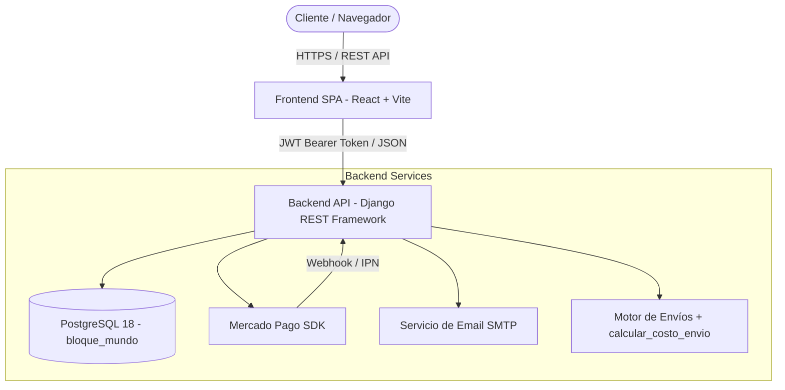

# 📖 Documentación Integral del Sistema Ecommerce

---

## 1. Visión General del Proyecto

Esta plataforma es una solución integral de **Comercio Electrónico (E-commerce)** diseñada bajo una arquitectura desacoplada (*Client-Server Architecture*). Cuenta con un backend robusto basado en **Django REST Framework** y una interfaz moderna de aplicación de página única (SPA) desarrollada en **React + Vite**.

### 🌟 Capacidades Clave
* **Base de Datos PostgreSQL 18 (`bloque_mundo`):** 15 tablas de dominio con 7 triggers, 2 vistas (`vista_reporte_ventas`, `vista_inventario_critico`), 3 funciones y 4 stored procedures PL/pgSQL.
* **Catálogo, Edades, Sagas y Combos:** Filtros por 5 rangos etarios, 18 sagas/películas, ofertas activas y combos con precio cerrado y descuento automático de stock de los sets incluidos al concretar la compra.
* **Carrito Anti-Fantasma y Lista de Deseos:** Soporte para usuarios autenticados e invitados, sanitización automática de stock y sin bloqueo prematuro de inventario.
* **Pasarela de Pagos (Mercado Pago):** Integración con Checkout Pro (ARS), auto-retorno inteligente para URLs HTTPS, webhooks y reposición automática de stock en cancelaciones mediante trigger.
* **Cotización de Envíos Dinámica:** Cálculo por Código Postal integrando la función PostgreSQL `calcular_costo_envio(cp)` con Correo Argentino y regla de envío gratis sobre $50.000 ARS.
* **Panel de Control Administrativo (Dashboard):** Gestión de productos, combos y reportes de ventas desde `/admin/productos`.

---

## 2. Arquitectura General del Sistema



---

## 3. Backend (Django & Django REST Framework)

El backend sigue la arquitectura modular nativa de Django, donde cada funcionalidad de negocio está aislada en una **Aplicación (App)** independiente.

```bash
backend/ecommerce/
├── analitica/          # Métricas de ventas y estadísticas para administradores
├── carrito/            # Persistencia de items y totales del carrito de compras
├── categorias/         # Clasificación jerárquica de productos
├── cupones/            # Sistema de descuentos y códigos promocionales
├── deseos/             # Lista de favoritos (Wishlist)
├── ecommerce/          # Configuración global del proyecto (settings, urls, wsgi)
├── envios/             # Motor de cálculo y cotización de envíos (Correo Argentino)
├── notificaciones/     # Plantillas y despacho de correos transaccionales
├── ofertas/            # Descuentos temporales y promociones
├── ordenes/            # Procesamiento de pedidos, estados y facturación
├── pagos/              # Integración de Mercado Pago (Checkout Pro y Webhooks)
├── productos/          # Catálogo, variantes, stock e imágenes
├── reseñas/            # Calificaciones y comentarios de usuarios
└── usuarios/           # Autenticación, perfiles y permisos JWT
```

### 🧩 Flujo de Datos por Aplicación
Cada aplicación de Django sigue el patrón estándar:
1. **`models.py`**: Define la estructura de tablas y relaciones en la base de datos (ORM).
2. **`serializers.py`**: Transforma objetos de Python a formato JSON (y viceversa) con validación de datos.
3. **`views.py` / `viewsets.py`**: Contiene la lógica de negocio y las respuestas HTTP a los endpoints.
4. **`urls.py`**: Expone las rutas REST consumidas por el cliente frontend.

### 🔐 Seguridad y Autenticación
* **JSON Web Tokens (JWT):** Autenticación *stateless* mediante tokens de acceso y refresco (`SimpleJWT`).
* **CORS (Cross-Origin Resource Sharing):** Configurado para permitir peticiones seguras desde el origen del cliente React.
* **Control de Acceso basado en Roles:** Diferenciación entre usuarios clientes, personal administrativo (*staff*) y superadministradores.

---

## 4. Frontend (React + Vite)

El frontend está construido como una SPA responsiva, modular y con diseño moderno.

### 📁 Estructura del Frontend
```bash
frontend/tienda/src/
├── assets/
│   ├── components/     # Componentes reutilizables (Header, Footer, ProductCard, etc.)
│   └── pages/          # Vistas principales (Inicio, Carrito, Checkout, AdminDashboard, etc.)
├── context/            # Proveedores de estado global (Context API)
│   ├── CarritoContext.jsx
│   └── DeseosContext.jsx
├── services/           # Clientes HTTP y conexión a endpoints (Axios / Fetch)
│   ├── api.js
│   ├── carritoService.js
│   ├── productoService.js
│   └── ...
├── routes.jsx          # Configuración central de rutas y navegación
├── App.jsx             # Componente raíz con envoltura de proveedores
└── main.jsx            # Punto de entrada de la aplicación React
```

### 🎣 Hooks de React Utilizados
1. **Hooks Nativos de React:**
   * `useState`: Manejo del estado local (cargas, modales, formularios, filtros).
   * `useEffect`: Ciclo de vida y efectos secundarios (peticiones a la API al montar componentes).
   * `useContext`: Consumo de contextos globales sin prop-drilling.
   * `useRef`: Manipulación directa de elementos DOM y preservación de valores mutables.
2. **Custom Hooks del Proyecto:**
   * `useCarrito()`: Abstracción completa de métodos de carrito (agregar, remover, actualizar cantidad, sincronizar con backend).
   * `useDeseos()`: Gestión de lista de deseos y favoritos del usuario.
3. **Hooks de Enrutamiento (`react-router-dom`):**
   * `useNavigate()`: Redirección programática en flujos de compra y login.
   * `useParams()`: Lectura de identificadores dinámicos en URLs (`/producto/:id`).
   * `useSearchParams()`: Procesamiento de query parameters (parámetros de retorno de pasarelas de pago).

---

## 5. Módulos e Integraciones Especiales

### 💳 Integración de Mercado Pago (Checkout Pro)
1. **Creación de Preferencia:** El frontend solicita una preferencia de pago al backend enviando el identificador de la orden.
2. **Redirección al Checkout:** El usuario abona en el entorno seguro de Mercado Pago.
3. **Auto-Return & Webhooks:**
   * Tras la aprobación, el usuario regresa a `/pago/exitoso/` con feedback inmediato.
   * El webhook del backend (`/api/pagos/webhook/`) recibe la notificación IPN oficial de Mercado Pago, verifica el estado del pago, actualiza la orden a `pagado` y descuenta el stock de productos.

### 🚚 Motor de Cotización de Envíos
* **Cálculo por Código Postal:** Detecta la provincia y región a partir del CP ingresado.
* **Modalidades:**
  * Envío a Domicilio (Correo Argentino).
  * Retiro en Sucursal de Correo.
  * Retiro en Local Comercial (Sin costo).
* **Regla de Envío Gratis:** Bonificación automática del 100% del costo de envío para compras que superen el monto configurable (por defecto $50.000 ARS).

### 📧 Sistema de Notificaciones por Correo
Envío automatizado de correos con formato responsive y estilizado:
* `orden_confirmada.html`: Confirmación de creación del pedido y datos bancarios/envío.
* `pago_exitoso.html`: Comprobante de acreditación de pago.
* `orden_enviada.html`: Código de seguimiento y aviso de despacho.

---

## 6. Guía de Instalación y Ejecución Local

### Prerrequisitos
* **Python** 3.10 o superior
* **Node.js** 18 o superior & **npm**
* **Git**

### 1. Puesta en marcha del Backend (Django)
```bash
# 1. Navegar al directorio del backend
cd backend/ecommerce

# 2. Crear y activar el entorno virtual
python -m venv venv
venv\Scripts\activate       # En Windows
# source venv/bin/activate   # En Linux / macOS

# 3. Instalar dependencias
pip install -r requirements.txt

# 4. Configurar variables de entorno (.env)
# Duplicar .env.example como .env y definir credenciales de Mercado Pago y base de datos

# 5. Aplicar migraciones
python manage.py migrate

# 6. (Opcional) Crear superadministrador
python manage.py createsuperuser

# 7. Iniciar servidor
python manage.py runserver
```
📍 *Backend disponible en:* `http://localhost:8000`

---

### 2. Puesta en marcha del Frontend (React + Vite)
```bash
# 1. Navegar al directorio del frontend
cd frontend/tienda

# 2. Instalar dependencias de Node
npm install

# 3. Iniciar servidor de desarrollo
npm run dev
```
📍 *Frontend disponible en:* `http://localhost:5173`

---

## 7. Variables de Entorno Clave (`.env`)

```ini
# Configuración Django
SECRET_KEY=tu_clave_secreta_aqui
DEBUG=True
ALLOWED_HOSTS=localhost,127.0.0.1

# Base de Datos PostgreSQL 18
DB_NAME=bloque_mundo
DB_USER=postgres
DB_PASSWORD=tu_password_postgres
DB_HOST=127.0.0.1
DB_PORT=5432

# Pasarela de Pagos (Mercado Pago)
MERCADOPAGO_PUBLIC_KEY=TEST-xxxxxxxx-xxxx-xxxx-xxxx-xxxxxxxxxxxx
MERCADOPAGO_ACCESS_TOKEN=TEST-xxxxxxxxxxxxxxxxxxxxxxxxxxxxxxxxxxxxxxxxxx

# Correo SMTP (Notificaciones)
EMAIL_HOST=smtp.gmail.com
EMAIL_PORT=587
EMAIL_HOST_USER=tu_correo@gmail.com
EMAIL_HOST_PASSWORD=tu_contraseña_de_aplicacion
EMAIL_USE_TLS=True
```
